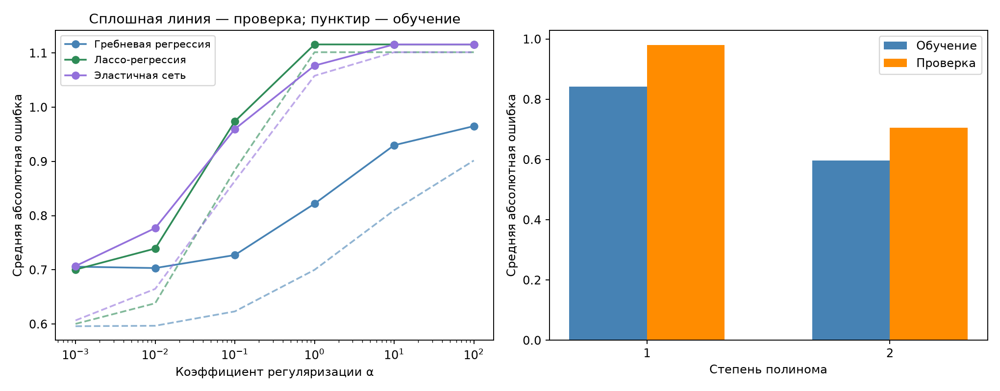
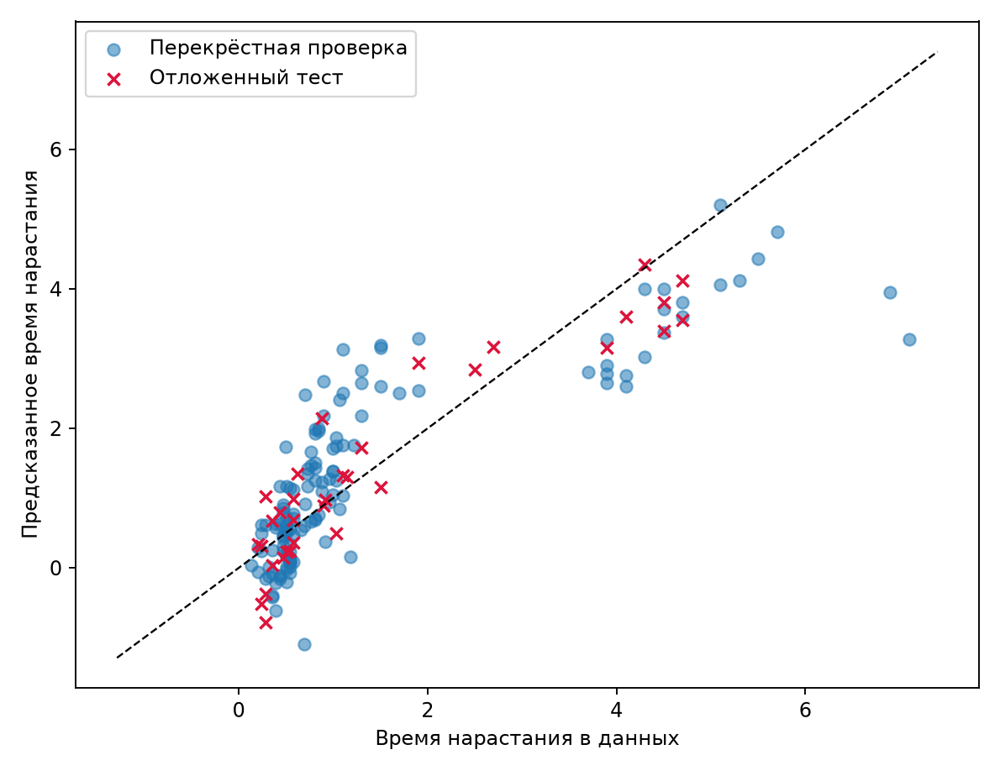
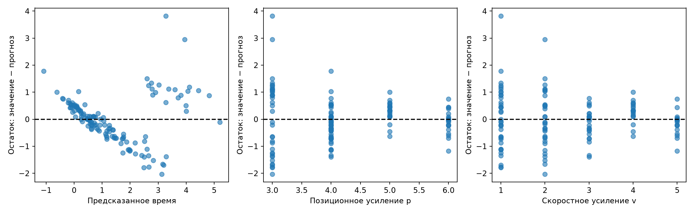
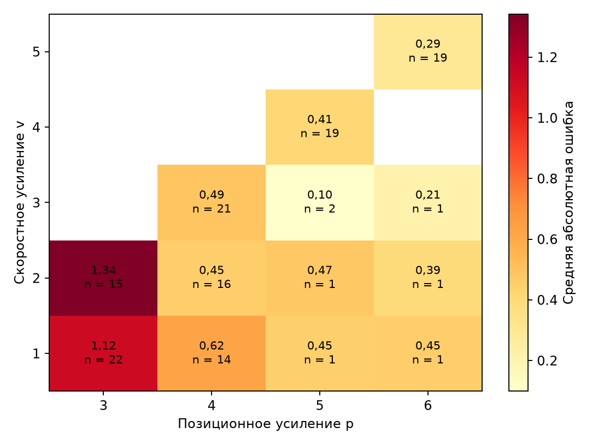
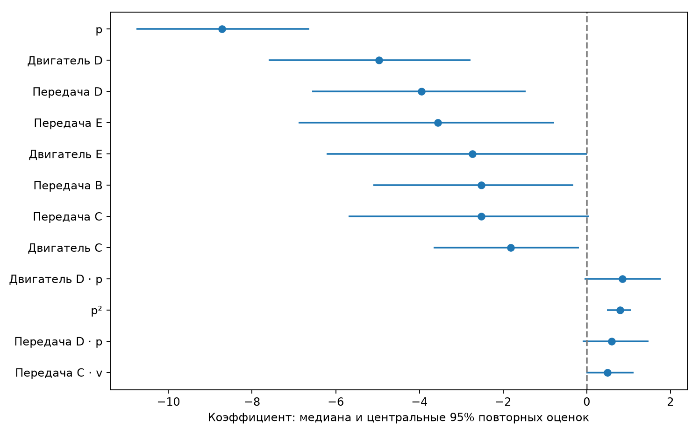

# Прогноз времени нарастания сервопривода линейной моделью

## 1. Задача и данные

Цель работы — предсказать время нарастания переходного процесса сервопривода
по настройкам усиления и типу механической передачи. Требуется выяснить,
может ли линейная модель дать достаточно точное и устойчивое описание отклика
и в каких режимах её применение становится ненадёжным.

Использован набор Servo из репозитория UCI: 167 наблюдений, полученных Карлом
Ульрихом в MIT в 1986 году и переданных в репозиторий Россом Куинланом в 1993 году.
Описанная установка включает усилитель, двигатель, винтовую передачу и подвижную
каретку. По сведениям автора, данные получены при моделировании системы.

Время нарастания характеризует быстроту реакции привода на ступенчатое изменение
заданного положения. В исходном описании такая интерпретация отклика названа
предположительной; точное определение времени и единицы измерения не приведены.
Поэтому далее время и ошибки выражены **в единицах исходного набора данных**,
без перевода в секунды. Отсутствие единиц не позволяет выполнить перевод
в систему СИ.

| Обозначение в данных | Смысл | Наблюдаемые значения |
|---|---|---|
| `motor` | Тип двигателя | A, B, C, D, E |
| `screw` | Тип винтовой передачи | A, B, C, D, E |
| `pgain`, далее p | Настройка позиционного усиления | 3, 4, 5, 6 |
| `vgain`, далее v | Настройка скоростного усиления | 1, 2, 3, 4, 5 |
| y | Время нарастания | От 0,131 до 7,100 |

Единицы усилений также не указаны. Их названия трактуются по обозначениям
переменных; подробной схемы регулятора нет. Пропусков и повторяющихся
конфигураций в данных не обнаружено. Буквы A–E обозначают разные конструкции,
а не числовую шкалу: например, двигатель E не считается «больше» двигателя A.

## 2. Физические предположения и выбор признаков

До обучения сформулированы три проверяемых предположения:

1. При прочих равных увеличение позиционного усиления обычно сокращает время нарастания.
2. Влияние скоростного усиления зависит от позиционного усиления: их эффекты нельзя полностью разделить.
3. Разные двигатели и передачи по-разному реагируют на изменение усилений.

Для проверки первого предположения сопоставлялись наблюдения с одинаковыми
двигателем, передачей и скоростным усилением. Второе и третье проверялись
сравнением моделей с соответствующими произведениями признаков и без них.

Модели для исходного времени линейны по оцениваемым коэффициентам:

$$
\hat y=\beta_0+\sum_j\beta_j\varphi_j(x).
$$

При этом сами признаки могут быть нелинейными функциями входных величин.
В работе сравнивались следующие варианты:

* **Базовый прогноз:** одно и то же среднее время для всех наблюдений.
* **Метод наименьших квадратов (МНК):** исходные усиления и типы механики.
* **МНК с физически мотивированными преобразованиями:** вместо p и v
  использованы 1/p и v/p. Обратная величина проверяет предположение об ускорении
  отклика с ростом усиления, а отношение — о совместном влиянии двух настроек.
  Это приближённое описание, а не выведенный закон движения привода.
* **Полином второй степени:** добавлены p², pv и v². Отдельно проверены
  произведения усилений на признаки типа двигателя и передачи. Они позволяют
  наклону зависимости отличаться у разных механических конфигураций.
* **Регуляризованные модели:** гребневая регрессия, лассо-регрессия и эластичная
  сеть. Они ограничивают величины коэффициентов; лассо также может обращать
  часть из них в ноль. Это снижает чувствительность модели к малой выборке.

МНК подбирает коэффициенты по минимуму суммы квадратов ошибок. Гребневая
регрессия добавляет штраф за сумму квадратов коэффициентов, лассо — за сумму
их модулей, а эластичная сеть сочетает оба штрафа. Свободный член не штрафуется.

Для каждой категориальной переменной использованы четыре индикатора «0 или 1»;
вариант A принят за исходный уровень. Получено 10 признаков в исходной и физически
мотивированной моделях, 13 — с квадратами и произведением усилений и 29 —
при добавлении взаимодействий с механикой. Полином третьей степени не применялся:
объём данных мал, а оснований для дальнейшего усложнения не получено.

Преобразования усилений выполнялись относительно одной единицы их исходных шкал.
Для логарифма использовано ln(y/y₀), где y₀ равен одной единице времени набора.
Перед регуляризацией из каждого признака вычиталось среднее, а результат
делился на стандартное отклонение. Обе величины рассчитывались только
по обучающим наблюдениям.

## 3. Как проверялись модели

Сначала случайным образом отложены 34 наблюдения для окончательного теста.
Остальные 133 использованы для обучения и выбора модели. Тестовые значения
не участвовали ни в выборе признаков, ни в настройке коэффициента регуляризации.

На обучающей части проведена **вложенная перекрёстная проверка**. Во внешнем
цикле данные делились на пять частей: модель обучалась на четырёх и проверялась
на оставшейся. Разбиение повторено три раза, всего получено 15 внешних оценок.
Внутри каждого обучения ещё одна проверка по схеме «пять частей, три повтора»
выбирала признаки и силу регуляризации. По той же схеме выполнен окончательный
выбор на всех 133 обучающих наблюдениях. Обработка категорий, построение признаков
и стандартизация каждый раз выполнялись заново, без проверочной части.

Коэффициент регуляризации выбирался из 0,001; 0,01; 0,1; 1; 10; 100.
Для эластичной сети доля штрафа лассо составляла 0,2 или 0,8. Основной критерий —
средняя абсолютная ошибка. Среди близких по точности вариантов предпочтение
отдавалось меньшему числу признаков: допустимое отклонение от лучшей оценки
равнялось стандартному отклонению ошибок, делённому на √15. Это правило выбора
сложности, а не доверительный интервал: повторные разбиения зависимы.
Для воспроизведения разбиений заданы начальные значения генераторов 42
(внешнее разбиение и тест) и 142 (внутренний подбор).

Использованы три показателя качества:

* **MAE** — средняя абсолютная ошибка; показывает типичную величину отклонения.
* **RMSE** — корень из средней квадратичной ошибки; сильнее реагирует на большие промахи.
* **R²** — доля объяснённого разброса отклика. Отрицательное значение означает,
  что прогноз хуже константы, равной среднему значению проверяемой группы.

## 4. Точность и выбор итоговой модели

В таблице приведены ошибки внешней перекрёстной проверки. Запись «среднее ±
стандартное отклонение» показывает, насколько результат менялся между 15
разбиениями. Во всех случаях ошибка рассчитана в исходной шкале времени,
в том числе после обучения на логарифме.

| Модель                         | Проверочная MAE, цель y   | Проверочная MAE, цель ln(y)   |
|:-------------------------------|:--------------------------|:------------------------------|
| Прогноз средним                | 1,116 ± 0,186             | 0,895 ± 0,289                 |
| МНК, исходные признаки         | 0,957 ± 0,124             | 0,614 ± 0,205                 |
| МНК, физические преобразования | 0,834 ± 0,096             | 0,489 ± 0,148                 |
| Полином второй степени         | 0,679 ± 0,088             | 0,455 ± 0,143                 |
| Гребневая регрессия            | 0,692 ± 0,086             | 0,447 ± 0,151                 |
| Лассо-регрессия                | 0,661 ± 0,112             | 0,427 ± 0,133                 |
| Эластичная сеть                | 0,687 ± 0,084             | 0,431 ± 0,143                 |

Исходная линейная зависимость описывает данные недостаточно точно.
Обратные величины усилений улучшают результат, а квадратичные признаки и
взаимодействия с механикой дают дальнейшее снижение ошибки. Среди моделей
для исходного времени наименьшая средняя ошибка у лассо-регрессии.

**Итоговая модель — лассо-регрессия второй степени с взаимодействиями усилений
и типа механики, α = 0,001.** Из 29 коэффициентов
при признаках 26 ненулевые. Получены следующие оценки:

| Оценка                |   MAE |   RMSE |    R² |
|:----------------------|------:|-------:|------:|
| Обучение              | 0,482 |  0,654 | 0,822 |
| Перекрёстная проверка | 0,661 |  0,883 | 0,583 |
| Отложенный тест       | 0,483 |  0,590 | 0,856 |

Отдельно проверена вся процедура выбора между семействами моделей, а не только
лассо. Её внешняя MAE равна 0,679 ± 0,083,
RMSE — 0,895 ± 0,142,
R² — 0,537 ± 0,311. Тестовая ошибка меньше средней
проверочной, поэтому опираться только на благоприятный результат 34 тестовых
наблюдений было бы недостаточно.

Обучение на ln(y) улучшает точность: например, для лассо проверочная MAE снижается
до 0,427, а тестовая — до 0,333.
Однако после обратного преобразования прогноз имеет вид exp(β₀ + Σβⱼφⱼ)
и уже не является линейным по коэффициентам в исходной шкале времени.
Поэтому он приведён для сравнения, а итоговая модель предсказывает непосредственно y.
Обратное преобразование выполнено без поправки на смещение среднего прогноза.
При обучении на логарифме базовый прогноз равен геометрическому среднему времени.

На рисунке видно недообучение простой линейной модели: велики и обучающая,
и проверочная ошибки. Вторая степень уменьшает обе ошибки. Слишком сильная
регуляризация снова ухудшает прогноз. Для сравнения силы штрафа на левом
графике зафиксирован один и тот же набор из 13 признаков. Численные значения
α между методами напрямую не сопоставляются из-за разной нормировки штрафов.

## 5. Где модель ошибается

На диагонали находятся точные прогнозы. Кружки показывают среднее трёх
проверочных прогнозов для каждого обучающего наблюдения; каждый из них
получен без использования этого наблюдения в обучении. Крестики — отдельный
отложенный тест. Такая усреднённая картина используется для диагностики,
а численные оценки качества выше рассчитаны по отдельным разбиениям.
Под значением из данных здесь понимается результат моделирования, а не новое
экспериментальное измерение.

Остаток — разность между значением из данных и прогнозом. В остатках видна
структура: они образуют несколько ветвей и зависят от предсказанного времени.
Ранговая корреляция с прогнозом равна -0,264.
Корреляции с p и v близки к нулю (0,004 и -0,009),
но это не означает отсутствия ошибки по режимам: особенно велик разброс при p = 3.

В ячейках указаны средняя абсолютная ошибка и число наблюдений n.
Пустые ячейки означают отсутствие данных. При p = 3 ошибка составляет
в среднем 1,211; при остальных значениях p —
от 0,301 до 0,512.
Оценки по одной-двум точкам ненадёжны: диапазоны p и v заполнены неравномерно.

Есть и физически недопустимые результаты: на тесте получены три отрицательных
времени при p = 4, v = 1 и передаче C, для двигателей B, C и E.
Следовательно, даже внутри наблюдаемого диапазона нельзя считать модель
пригодной для любой конфигурации. Отрицательные прогнозы не заменялись нулём:
в таком случае окончательная зависимость перестала бы быть строго линейной.

## 6. Физические гипотезы и устойчивость коэффициентов

**Рост позиционного усиления обычно ускоряет отклик.** В обучающей выборке
найдено 30 пар соседних значений p при одинаковых остальных
входах. В 93,3% случаев время уменьшалось, в остальных не менялось.
Гипотеза согласуется с данными. При этом у итогового полинома производная
по p отрицательна лишь в 82,0% обучающих конфигураций:
он не гарантирует монотонность во всём диапазоне.

**Совместное влияние двух усилений подтверждено слабо.** Добавление только pv
к модели с квадратами снижает среднюю проверочную MAE с
0,714 до 0,706.
Улучшение мало и не сохраняется на всех разбиениях. Поэтому уверенного
вывода о необходимости именно этого члена сделать нельзя.

**Зависимость от механической конфигурации заметна сильнее.** Разрешение
разных наклонов по усилениям для разных двигателей и передач снижает MAE
с 0,706 до 0,641.
Такое улучшение согласуется с третьей гипотезой.

Устойчивость коэффициентов проверена на 300 повторных выборках из обучающих
наблюдений, сформированных с возвращением. В каждом повторе коэффициенты
оценивались заново при фиксированных признаках и силе штрафа. Таблица показывает
медиану и диапазон, содержащий центральные 95% оценок. Для сравнения приведён
МНК с теми же признаками, но без регуляризации.

| Коэффициент при   |   Медиана, лассо | Диапазон 95%, лассо   | Частый знак и его доля   | Диапазон 95%, МНК   |
|:------------------|-----------------:|:----------------------|:-------------------------|:--------------------|
| p                 |           -8,724 | [-10,765; -6,627]     | − (100,0%)               | [-12,791; -7,614]   |
| p²                |            0,796 | [0,487; 1,052]        | + (100,0%)               | [0,657; 1,344]      |
| Двигатель D       |           -4,971 | [-7,608; -2,782]      | − (100,0%)               | [-8,689; -2,666]    |
| Передача D        |           -3,954 | [-6,564; -1,464]      | − (99,7%)                | [-7,782; -2,029]    |
| pv                |           -0,048 | [-0,334; 0,078]       | − (64,0%)                | [-0,842; 0,100]     |
| Передача C · v    |            0,494 | [-0,004; 1,116]       | + (95,0%)                | [-0,424; 1,086]     |

Знак сохраняется не менее чем в 95% повторов у 10 из 29 коэффициентов.
Стабильно отрицательны, например, коэффициенты при p и при индикаторе двигателя D;
коэффициент при p² положителен. Для pv и ряда взаимодействий знак меняется
или коэффициент обращается в ноль. Отдельные оценки поэтому нельзя надёжно
трактовать как самостоятельные физические эффекты.

Одна из причин — близость признаков: корреляция p и p² составляет 0,994.
Разные сочетания их коэффициентов могут давать похожие прогнозы. Лассо
уменьшает разброс ряда оценок по сравнению с МНК, но не устраняет эту
неоднозначность. Приведённые диапазоны не учитывают повторный выбор семейства
и набора признаков, поэтому описывают устойчивость только выбранной модели.

## 7. Проверка на исключённом режиме

Чтобы проверить перенос на другой диапазон усиления, из обучающей части
удалены все наблюдения с p = 3. На оставшихся 96 примерах заново выполнен
выбор модели; выбрана гребневая регрессия. Она проверена на тех же отложенных
данных: 21 наблюдении с p > 3 и 13 наблюдениях с p = 3. Для сравнения приведена
основная модель, в обучении которой режим p = 3 присутствовал.

| Модель                      | Проверяемый режим   |   Число примеров |   MAE |   RMSE |     R² |
|:----------------------------|:--------------------|-----------------:|------:|-------:|-------:|
| Без режима p = 3 в обучении | p > 3               |               21 | 0,155 |  0,210 |  0,474 |
| Без режима p = 3 в обучении | p = 3               |               13 | 1,837 |  2,206 | -1,572 |
| С режимом p = 3 в обучении  | p > 3               |               21 | 0,429 |  0,535 | -2,404 |
| С режимом p = 3 в обучении  | p = 3               |               13 | 0,571 |  0,670 |  0,763 |

Без данных о режиме p = 3 ошибка при переносе в него возрастает до 1,837,
тогда как для представленного в обучении диапазона составляет 0,155.
Это показывает, что продолжение зависимости за нижнюю границу обучающего
диапазона не описывает резкий рост времени нарастания. Вместе с тем группы
малы и различаются по составу механики, поэтому это оценка надёжности прогноза,
а не доказательство причинного влияния одного усиления. Отрицательные R²
в отдельных группах также показывают, что высокий общий R² скрывает
неудовлетворительное описание некоторых режимов.

## 8. Выводы

Квадратичная лассо-регрессия описывает отклик лучше простой линейной модели.
На отложенном тесте её MAE равна 0,483,
RMSE — 0,590, R² — 0,856.
Однако получить одновременно очень компактную, точную и устойчивую по всем
коэффициентам модель не удалось: из 29 признаков сохранены 26, а знак
устойчив только у 10 коэффициентов. Физически мотивированная модель из
10 признаков проще, но заметно уступает по точности.

Наиболее сложная область — малое позиционное усиление p = 3. Перенос в этот
режим без соответствующих обучающих данных ненадёжен. Дополнительный отказ
наблюдается при p = 4, v = 1 и передаче C: модель может предсказывать
отрицательное время. Поэтому полученная зависимость пригодна как приближённое
описание части наблюдаемых режимов, но не как универсальный закон сервопривода.

## Приложение. Подробные результаты и формула

В следующих таблицах приведены все три показателя для обучения, перекрёстной
проверки и отложенного теста. Знак ± относится только к разбросу между
проверочными разбиениями; это не доверительный интервал среднего.

### Обучение на исходном времени y

| Модель                         | Выборка   | MAE           | RMSE          | R²             |
|:-------------------------------|:----------|:--------------|:--------------|:---------------|
| Прогноз средним                | Обучение  | 1,103         | 1,552         | 0,000          |
| Прогноз средним                | Проверка  | 1,116 ± 0,186 | 1,530 ± 0,369 | -0,150 ± 0,261 |
| Прогноз средним                | Тест      | 1,224         | 1,570         | -0,020         |
| МНК, исходные признаки         | Обучение  | 0,862         | 1,065         | 0,529          |
| МНК, исходные признаки         | Проверка  | 0,957 ± 0,124 | 1,167 ± 0,186 | 0,259 ± 0,397  |
| МНК, исходные признаки         | Тест      | 0,765         | 0,929         | 0,643          |
| МНК, физические преобразования | Обучение  | 0,743         | 0,920         | 0,649          |
| МНК, физические преобразования | Проверка  | 0,834 ± 0,096 | 1,017 ± 0,153 | 0,424 ± 0,339  |
| МНК, физические преобразования | Тест      | 0,617         | 0,727         | 0,781          |
| Полином второй степени         | Обучение  | 0,480         | 0,645         | 0,827          |
| Полином второй степени         | Проверка  | 0,679 ± 0,088 | 0,889 ± 0,150 | 0,535 ± 0,322  |
| Полином второй степени         | Тест      | 0,460         | 0,551         | 0,875          |
| Гребневая регрессия            | Обучение  | 0,479         | 0,646         | 0,827          |
| Гребневая регрессия            | Проверка  | 0,692 ± 0,086 | 0,912 ± 0,144 | 0,519 ± 0,309  |
| Гребневая регрессия            | Тест      | 0,464         | 0,558         | 0,871          |
| Лассо-регрессия                | Обучение  | 0,482         | 0,654         | 0,822          |
| Лассо-регрессия                | Проверка  | 0,661 ± 0,112 | 0,883 ± 0,182 | 0,583 ± 0,192  |
| Лассо-регрессия                | Тест      | 0,483         | 0,590         | 0,856          |
| Эластичная сеть                | Обучение  | 0,484         | 0,660         | 0,819          |
| Эластичная сеть                | Проверка  | 0,687 ± 0,084 | 0,907 ± 0,142 | 0,531 ± 0,294  |
| Эластичная сеть                | Тест      | 0,476         | 0,589         | 0,857          |

### Обучение на ln(y), ошибки после возврата к исходной шкале

| Модель                         | Выборка   | MAE           | RMSE          | R²             |
|:-------------------------------|:----------|:--------------|:--------------|:---------------|
| Прогноз средним                | Обучение  | 0,888         | 1,625         | -0,097         |
| Прогноз средним                | Проверка  | 0,895 ± 0,289 | 1,562 ± 0,492 | -0,123 ± 0,104 |
| Прогноз средним                | Тест      | 1,126         | 1,706         | -0,203         |
| МНК, исходные признаки         | Обучение  | 0,568         | 1,018         | 0,570          |
| МНК, исходные признаки         | Проверка  | 0,614 ± 0,205 | 1,028 ± 0,327 | 0,503 ± 0,112  |
| МНК, исходные признаки         | Тест      | 0,696         | 1,063         | 0,533          |
| МНК, физические преобразования | Обучение  | 0,445         | 0,820         | 0,721          |
| МНК, физические преобразования | Проверка  | 0,489 ± 0,148 | 0,834 ± 0,284 | 0,666 ± 0,112  |
| МНК, физические преобразования | Тест      | 0,468         | 0,755         | 0,765          |
| Полином второй степени         | Обучение  | 0,393         | 0,703         | 0,795          |
| Полином второй степени         | Проверка  | 0,455 ± 0,143 | 0,775 ± 0,278 | 0,715 ± 0,094  |
| Полином второй степени         | Тест      | 0,399         | 0,633         | 0,834          |
| Гребневая регрессия            | Обучение  | 0,320         | 0,670         | 0,814          |
| Гребневая регрессия            | Проверка  | 0,447 ± 0,151 | 0,787 ± 0,294 | 0,711 ± 0,099  |
| Гребневая регрессия            | Тест      | 0,325         | 0,515         | 0,890          |
| Лассо-регрессия                | Обучение  | 0,317         | 0,653         | 0,823          |
| Лассо-регрессия                | Проверка  | 0,427 ± 0,133 | 0,755 ± 0,270 | 0,730 ± 0,088  |
| Лассо-регрессия                | Тест      | 0,333         | 0,505         | 0,895          |
| Эластичная сеть                | Обучение  | 0,318         | 0,658         | 0,820          |
| Эластичная сеть                | Проверка  | 0,431 ± 0,143 | 0,764 ± 0,286 | 0,726 ± 0,094  |
| Эластичная сеть                | Тест      | 0,334         | 0,510         | 0,893          |

### Формула итоговой модели

При исходных шкалах p и v прогноз задаётся выражением

$$
\hat y=24.328682-8.878944p+0.582139v+0.803754p^2-0.087204pv
+\Delta_M(p,v)+\Delta_S(p,v).
$$

Здесь ΔM и ΔS — поправки для двигателя и передачи. Для варианта A поправка
равна нулю. Для остальных вариантов она имеет вид a + bp + cv:

| Конфигурация   | a         | b         | c         |
|:---------------|:----------|:----------|:----------|
| Двигатель B    | 0,312594  | -0,216723 | 0,193660  |
| Двигатель C    | -2,108216 | 0,400080  | 0,005276  |
| Двигатель D    | -5,367346 | 0,988640  | 0,000000  |
| Двигатель E    | -3,157992 | 0,598884  | 0,000000  |
| Передача B     | -2,743779 | 0,577599  | -0,127923 |
| Передача C     | -2,543269 | 0,029063  | 0,506905  |
| Передача D     | -4,232173 | 0,682235  | 0,088087  |
| Передача E     | -3,596136 | 0,460060  | 0,228523  |

Коэффициент при v² равен нулю. Значения в формуле и таблице округлены
до шести знаков после запятой. Поправки относятся к выбранному полиному
и не являются характеристиками двигателей или передач вне этой модели.

**Источник данных:** [Ulrich, K. Servo. UCI Machine Learning Repository](https://archive.ics.uci.edu/dataset/87/servo).
DOI: 10.24432/C5Q30F. Лицензия CC BY 4.0.
