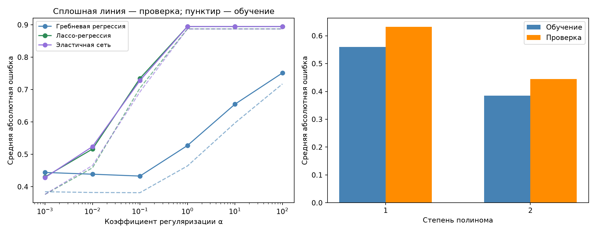
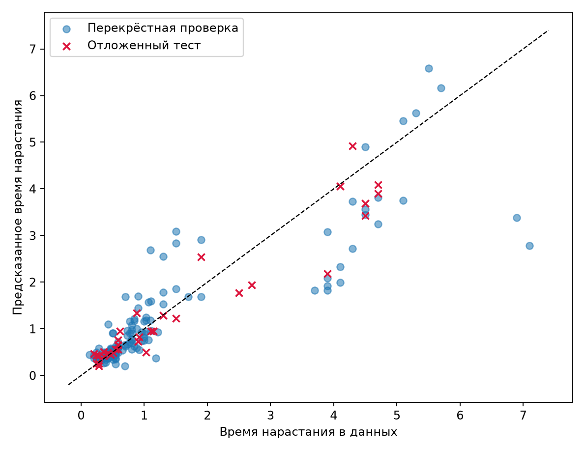
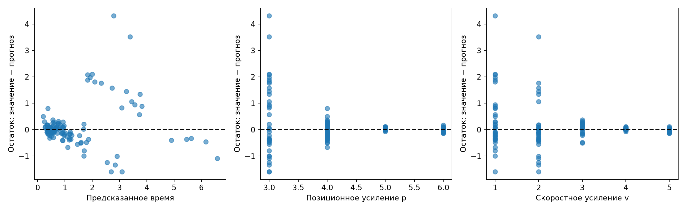
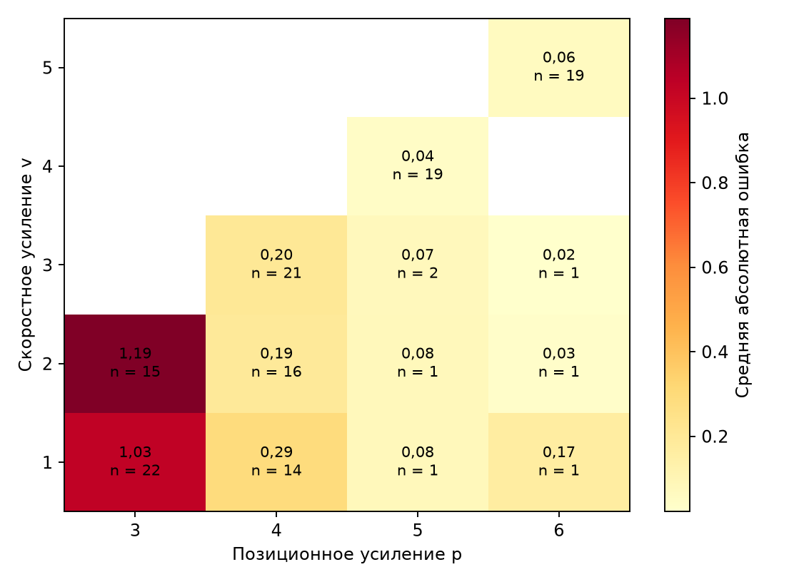
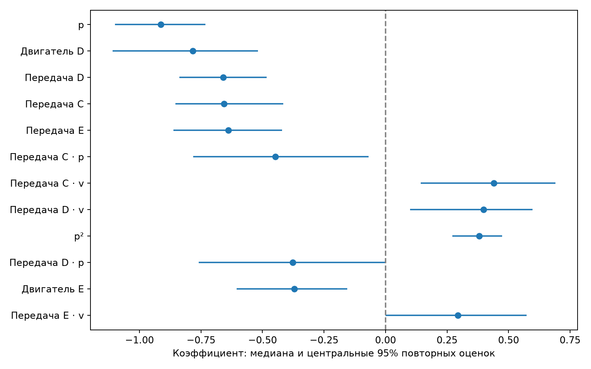

# Прогноз времени нарастания сервопривода линейной моделью

## 1. Задача и данные

Цель работы — предсказать время нарастания переходного процесса сервопривода
по настройкам усиления и типу механической передачи. Требуется выяснить,
может ли линейная модель дать достаточно точное и устойчивое описание отклика
и в каких режимах её применение становится ненадёжным.

Использован набор Servo из репозитория UCI: 167 наблюдений, полученных Карлом
Ульрихом в MIT в 1986 году и переданных в репозиторий Россом Куинланом в 1993 году.
Описанная установка включает усилитель, двигатель, винтовую передачу и подвижную
каретку. По сведениям автора, данные получены при моделировании системы.

Время нарастания характеризует быстроту реакции привода на ступенчатое изменение
заданного положения. В исходном описании такая интерпретация отклика названа
предположительной; точное определение времени и единицы измерения не приведены.
Поэтому далее время и ошибки выражены **в единицах исходного набора данных**,
без перевода в секунды. Отсутствие единиц не позволяет выполнить перевод
в систему СИ.

| Обозначение в данных | Смысл | Наблюдаемые значения |
|---|---|---|
| `motor` | Тип двигателя | A, B, C, D, E |
| `screw` | Тип винтовой передачи | A, B, C, D, E |
| `pgain`, далее p | Настройка позиционного усиления | 3, 4, 5, 6 |
| `vgain`, далее v | Настройка скоростного усиления | 1, 2, 3, 4, 5 |
| y | Время нарастания | От 0,131 до 7,100 |

Единицы усилений также не указаны. Их названия трактуются по обозначениям
переменных; подробной схемы регулятора нет. Пропусков и повторяющихся
конфигураций в данных не обнаружено. Буквы A–E обозначают разные конструкции,
а не числовую шкалу: например, двигатель E не считается «больше» двигателя A.

## 2. Физические предположения и выбор признаков

До обучения сформулированы три проверяемых предположения:

1. При прочих равных увеличение позиционного усиления обычно сокращает время нарастания.
2. Влияние скоростного усиления зависит от позиционного усиления: их эффекты нельзя полностью разделить.
3. Разные двигатели и передачи по-разному реагируют на изменение усилений.

Для проверки первого предположения сопоставлялись наблюдения с одинаковыми
двигателем, передачей и скоростным усилением. Второе и третье проверялись
сравнением моделей с соответствующими произведениями признаков и без них.

Итоговая модель описывает логарифм времени линейной комбинацией признаков.
Переход к исходной шкале выполняется с помощью экспоненты.

$$
\widehat{\ln(y/y_0)}=\eta(x)=\beta_0+\sum_j\beta_j\varphi_j(x),\qquad \hat y=y_0\exp(\eta(x)).
$$

Здесь y₀ равен одной единице времени набора. Экспонента даёт положительное
время и делает прогноз нелинейным по коэффициентам в исходной шкале.
При прямом обучении на времени использовалась та же линейная комбинация признаков.
В работе сравнивались следующие варианты:

* **Базовый прогноз:** одно и то же среднее время для всех наблюдений.
* **Метод наименьших квадратов (МНК):** исходные усиления и типы механики.
* **МНК с физически мотивированными преобразованиями:** вместо p и v
  использованы 1/p и v/p. Обратная величина проверяет предположение об ускорении
  отклика с ростом усиления, а отношение — о совместном влиянии двух настроек.
  Это приближённое описание, а не выведенный закон движения привода.
* **Полином второй степени:** добавлены p², pv и v². Отдельно проверены
  произведения усилений на признаки типа двигателя и передачи. Они позволяют
  наклону зависимости отличаться у разных механических конфигураций.
* **Регуляризованные модели:** гребневая регрессия, лассо-регрессия и эластичная
  сеть. Они ограничивают величины коэффициентов; лассо также может обращать
  часть из них в ноль. Это снижает чувствительность модели к малой выборке.

МНК подбирает коэффициенты по минимуму суммы квадратов ошибок. Гребневая
регрессия добавляет штраф за сумму квадратов коэффициентов, лассо — за сумму
их модулей, а эластичная сеть сочетает оба штрафа. Свободный член не штрафуется.

Для каждой категориальной переменной использованы четыре индикатора «0 или 1»;
вариант A принят за исходный уровень.

## 3. Как проверялись модели

Сначала случайным образом отложены 34 наблюдения для окончательного теста.
Остальные 133 использованы для обучения и выбора модели. Тестовые значения
не участвовали ни в выборе признаков, ни в настройке коэффициента регуляризации.

На обучающей части проведена **вложенная перекрёстная проверка**. Во внешнем
цикле данные делились на пять частей: модель обучалась на четырёх и проверялась
на оставшейся. Разбиение повторено три раза, всего получено 15 внешних оценок.
Внутри каждого обучения ещё одна проверка по схеме «пять частей, три повтора»
выбирала признаки и силу регуляризации. По той же схеме выполнен окончательный
выбор на всех 133 обучающих наблюдениях. Обработка категорий, построение признаков
и стандартизация каждый раз выполнялись заново, без проверочной части.

Число признаков составляло 10 в исходной и физически мотивированной моделях,
13 с квадратами и произведением усилений и 29 с взаимодействиями механики
и усилений. Для этого объёма данных подбор ограничили второй степенью.

Преобразования усилений выполнялись относительно одной единицы их исходных шкал.
Для логарифма использовано ln(y/y₀), где y₀ равен одной единице времени набора.
Перед регуляризацией признаки стандартизировали. В варианте с ранним
центрированием из усилений дополнительно вычитали их средние до вычисления
квадратов и произведений. Все средние и стандартные отклонения рассчитывались
только на обучающей части каждого разбиения.

Коэффициент регуляризации выбирался из 0,001; 0,01; 0,1; 1; 10; 100.
Для эластичной сети доля штрафа лассо составляла 0,2 или 0,8. Основной критерий —
средняя абсолютная ошибка в единицах времени. Силу штрафа, набор признаков
и итоговое семейство выбирали по минимуму этой ошибки. Итоговую модель
выбирали среди моделей на логарифме, чтобы обеспечить положительный прогноз.
На отложенных 34 наблюдениях оценивали уже зафиксированные модели. Это то же
тестовое разбиение, результаты которого рассматривались ранее.
Для воспроизведения разбиений заданы начальные значения генераторов 42
(внешнее разбиение и тест) и 142 (внутренний подбор).

Использованы три показателя качества:

* **MAE** — средняя абсолютная ошибка; показывает типичную величину отклонения.
* **RMSE** — корень из средней квадратичной ошибки; сильнее реагирует на большие промахи.
* **R²** — доля объяснённого разброса отклика. Отрицательное значение означает,
  что прогноз хуже константы, равной среднему значению проверяемой группы.

## 4. Точность и выбор итоговой модели

В таблице приведена валидационная MAE, по которой выбирали итоговую модель.
Каждое семейство проверено на тех же 15 внутренних разбиениях 133 обучающих
наблюдений. Жирным выделен минимум среди моделей на логарифме времени.

| Семейство                      | Валидационная MAE   |
|:-------------------------------|:--------------------|
| Прогноз средним                | 0,8949              |
| МНК, исходные признаки         | 0,6319              |
| МНК, физические преобразования | 0,4934              |
| Полином второй степени         | 0,4449              |
| Гребневая регрессия            | 0,4039              |
| Лассо-регрессия                | 0,4032              |
| Эластичная сеть                | **0,4010**          |

**Выбрана модель «Эластичная сеть» для логарифма времени.** Степень полинома 2. В модель вошли взаимодействия усилений с типом механики. Коэффициент регуляризации α = 0,010. Доля штрафа лассо 0,2.
Центрирование выполняется до построения полинома. Из 29 коэффициентов
при признаках 26 ненулевые.

В таблице приведены ошибки внешней перекрёстной проверки. Запись «среднее ±
стандартное отклонение» показывает, насколько результат менялся между 15
разбиениями. Во всех случаях ошибка рассчитана в исходной шкале времени,
в том числе после обучения на логарифме.

| Модель                         | Проверочная MAE, цель y   | Проверочная MAE, цель ln(y)   |
|:-------------------------------|:--------------------------|:------------------------------|
| Прогноз средним                | 1,116 ± 0,186             | 0,895 ± 0,289                 |
| МНК, исходные признаки         | 0,957 ± 0,124             | 0,614 ± 0,205                 |
| МНК, физические преобразования | 0,834 ± 0,096             | 0,489 ± 0,148                 |
| Полином второй степени         | 0,679 ± 0,088             | 0,455 ± 0,143                 |
| Гребневая регрессия            | 0,692 ± 0,086             | 0,432 ± 0,140                 |
| Лассо-регрессия                | 0,661 ± 0,112             | 0,421 ± 0,137                 |
| Эластичная сеть                | 0,687 ± 0,084             | 0,427 ± 0,139                 |

Исходная линейная зависимость описывает данные недостаточно точно.
Обратные величины усилений улучшают результат. Квадратичные признаки и
регуляризация дают дальнейшее снижение ошибки. Среди моделей
для исходного времени наименьшая средняя ошибка у лассо-регрессии.

Для зафиксированной модели получены следующие оценки:

| Оценка                |   MAE |   RMSE |    R² |
|:----------------------|------:|-------:|------:|
| Обучение              | 0,312 |  0,661 | 0,819 |
| Перекрёстная проверка | 0,427 |  0,755 | 0,726 |
| Отложенный тест       | 0,373 |  0,554 | 0,873 |

В каждом внешнем разбиении также проверяли всю процедуру выбора модели
на логарифме. Её внешняя MAE равна 0,424 ± 0,138,
RMSE — 0,750 ± 0,281,
R² — 0,728 ± 0,102. Тестовая ошибка меньше средней
проверочной, поэтому опираться только на благоприятный результат 34 тестовых
наблюдений было бы недостаточно.

У лассо переход к логарифму снижает проверочную MAE с 0,661
до 0,421, а тестовую — с 0,483
до 0,333. Обратное преобразование даёт
оценку геометрического центра времени. Для базового прогноза это геометрическое среднее.

На рисунке видно недообучение простой линейной модели: велики и обучающая,
и проверочная ошибки. Вторая степень уменьшает обе ошибки. Слишком сильная
регуляризация снова ухудшает прогноз. Графики построены для моделей на логарифме.
Для сравнения силы штрафа на левом
графике зафиксирован один и тот же набор из 13 признаков с центрированием
после построения полинома. Численные значения
α между методами напрямую не сопоставляются из-за разной нормировки штрафов.

## 5. Где модель ошибается

На диагонали находятся точные прогнозы. Кружки показывают среднее трёх
проверочных прогнозов для каждого обучающего наблюдения; каждый из них
получен без использования этого наблюдения в обучении. Крестики — отдельный
отложенный тест. Такая усреднённая картина используется для диагностики,
а численные оценки качества выше рассчитаны по отдельным разбиениям.
Под значением из данных здесь понимается результат моделирования, а не новое
экспериментальное измерение.

Остаток — разность между значением из данных и прогнозом. Ранговая корреляция
остатков с прогнозом равна -0,063, с усилением p —
-0,036, а с усилением v — -0,017.
На карте ошибок видно, при каких настройках прогноз менее точен.

В ячейках указаны средняя абсолютная ошибка и число наблюдений n.
Пустые ячейки означают отсутствие данных. При p = 3 ошибка составляет
в среднем 1,094; при остальных значениях p —
от 0,050 до 0,223.
Оценки по одной-двум точкам ненадёжны: диапазоны p и v заполнены неравномерно.

Все 34 тестовых прогнозов положительны. Минимальное предсказанное
время равно 0,220. У модели того же семейства в исходной шкале
на том же тесте число неположительных прогнозов равно 3.

## 6. Физические гипотезы и устойчивость коэффициентов

**Рост позиционного усиления обычно ускоряет отклик.** В обучающей выборке
найдено 30 пар соседних значений p при одинаковых остальных
входах. В 93,3% случаев время уменьшалось, в остальных не менялось.
Гипотеза согласуется с данными. При этом у итогового прогноза производная
по p отрицательна лишь в 88,7% обучающих конфигураций:
он не гарантирует монотонность во всём диапазоне.

**Совместное влияние двух усилений.** При добавлении только pv к модели
на логарифме с квадратами и поздним центрированием средняя проверочная MAE меняется с
0,432 до 0,445.
В этом сравнении меньшая ошибка получена у модели с одними квадратами.

**Влияние механической конфигурации.** При добавлении взаимодействий усилений
с типами двигателей и передач MAE меняется
с 0,445 до 0,445.
Для МНК разница мала. Включение взаимодействий в итоговую модель определялось
валидацией вместе с настройкой регуляризации.

Устойчивость коэффициентов проверена на 300 повторных выборках из обучающих
наблюдений, сформированных с возвращением. В каждом повторе коэффициенты
оценивались заново при фиксированных признаках и силе штрафа. Таблица показывает
медиану и диапазон, содержащий центральные 95% оценок. Для сравнения приведён
МНК на той же логарифмической шкале с теми же признаками.
В каждом повторе средние усилений пересчитывались по новой выборке. В разброс оценок входит влияние этих средних.

| Коэффициент при   |   Медиана | Диапазон 95%     | Частый знак и его доля   | Диапазон 95%, МНК   |
|:------------------|----------:|:-----------------|:-------------------------|:--------------------|
| p                 |    -0,913 | [-1,099; -0,731] | − (100,0%)               | [-1,664; -0,810]    |
| p²                |     0,380 | [0,272; 0,474]   | + (100,0%)               | [0,240; 0,559]      |
| Двигатель D       |    -0,784 | [-1,109; -0,519] | − (100,0%)               | [-1,229; -0,536]    |
| Передача D        |    -0,660 | [-0,838; -0,484] | − (100,0%)               | [-0,902; -0,543]    |
| pv                |    -0,005 | [-0,094; 0,096]  | − (55,0%)                | [-0,366; 0,089]     |
| Передача C · v    |     0,440 | [0,143; 0,690]   | + (99,7%)                | [0,161; 0,913]      |

Знак сохраняется не менее чем в 95% повторов у 16 из 29 коэффициентов.
В таблице приведены коэффициенты для логарифма времени. Их знаки зависят
от набора признаков, поэтому влияние усиления следует оценивать по всей формуле.

Сильная корреляция признаков затрудняет интерпретацию коэффициентов. Разные
сочетания коэффициентов могут давать похожие прогнозы. Приведённые диапазоны
характеризуют выбранную конфигурацию модели при повторном обучении.

## 7. Проверка на исключённом режиме

Чтобы проверить перенос на другой диапазон усиления, из обучающей части
удалены все наблюдения с p = 3. На оставшихся 96 примерах заново
выполнен подбор среди моделей на логарифме. Выбрана эластичная сеть.
Она проверена на 21 отложенных наблюдениях с p > 3 и
13 наблюдениях с p = 3. Для сравнения приведена
основная модель, в обучении которой режим p = 3 присутствовал.

| Модель                      | Проверяемый режим   |   Число примеров |   MAE |   RMSE |     R² |
|:----------------------------|:--------------------|-----------------:|------:|-------:|-------:|
| Без режима p = 3 в обучении | p > 3               |               21 | 0,131 |  0,183 |  0,601 |
| Без режима p = 3 в обучении | p = 3               |               13 | 1,589 |  1,842 | -0,793 |
| С режимом p = 3 в обучении  | p > 3               |               21 | 0,155 |  0,208 |  0,485 |
| С режимом p = 3 в обучении  | p = 3               |               13 | 0,726 |  0,855 |  0,614 |

У модели, обученной при p > 3, MAE в этом же диапазоне равна 0,131.
При переносе на p = 3 она составляет 1,589. Размеры проверочных
групп невелики, а состав двигателей и передач различается. Результат относится
к тому, как модель переносится на исключённую настройку усиления.

## 8. Выводы

Итоговая модель для логарифма времени даёт положительный прогноз за счёт экспоненты.
На отложенном тесте MAE равна 0,373,
RMSE — 0,554, R² — 0,873.
Однако получить одновременно очень компактную, точную и устойчивую по всем
коэффициентам модель не удалось: из 29 признаков сохранены 26, а знак
устойчив только у 16 коэффициентов. Физически мотивированная модель из
10 признаков проще, но заметно уступает по точности.

Малое позиционное усиление p = 3 требует отдельной проверки. При переносе
в этот режим без соответствующих обучающих примеров MAE составляет 1,589.

## Приложение. Подробные результаты и формула

В следующих таблицах приведены все три показателя для обучения, перекрёстной
проверки и отложенного теста. Знак ± относится только к разбросу между
проверочными разбиениями; это не доверительный интервал среднего.

### Обучение на исходном времени y

| Модель                         | Выборка   | MAE           | RMSE          | R²             |
|:-------------------------------|:----------|:--------------|:--------------|:---------------|
| Прогноз средним                | Обучение  | 1,103         | 1,552         | 0,000          |
| Прогноз средним                | Проверка  | 1,116 ± 0,186 | 1,530 ± 0,369 | -0,150 ± 0,261 |
| Прогноз средним                | Тест      | 1,224         | 1,570         | -0,020         |
| МНК, исходные признаки         | Обучение  | 0,862         | 1,065         | 0,529          |
| МНК, исходные признаки         | Проверка  | 0,957 ± 0,124 | 1,167 ± 0,186 | 0,259 ± 0,397  |
| МНК, исходные признаки         | Тест      | 0,765         | 0,929         | 0,643          |
| МНК, физические преобразования | Обучение  | 0,743         | 0,920         | 0,649          |
| МНК, физические преобразования | Проверка  | 0,834 ± 0,096 | 1,017 ± 0,153 | 0,424 ± 0,339  |
| МНК, физические преобразования | Тест      | 0,617         | 0,727         | 0,781          |
| Полином второй степени         | Обучение  | 0,480         | 0,645         | 0,827          |
| Полином второй степени         | Проверка  | 0,679 ± 0,088 | 0,889 ± 0,150 | 0,535 ± 0,322  |
| Полином второй степени         | Тест      | 0,460         | 0,551         | 0,875          |
| Гребневая регрессия            | Обучение  | 0,479         | 0,646         | 0,827          |
| Гребневая регрессия            | Проверка  | 0,692 ± 0,086 | 0,912 ± 0,144 | 0,519 ± 0,309  |
| Гребневая регрессия            | Тест      | 0,464         | 0,558         | 0,871          |
| Лассо-регрессия                | Обучение  | 0,482         | 0,654         | 0,822          |
| Лассо-регрессия                | Проверка  | 0,661 ± 0,112 | 0,883 ± 0,182 | 0,583 ± 0,192  |
| Лассо-регрессия                | Тест      | 0,483         | 0,590         | 0,856          |
| Эластичная сеть                | Обучение  | 0,484         | 0,660         | 0,819          |
| Эластичная сеть                | Проверка  | 0,687 ± 0,084 | 0,907 ± 0,142 | 0,531 ± 0,294  |
| Эластичная сеть                | Тест      | 0,476         | 0,589         | 0,857          |

### Обучение на ln(y), ошибки после возврата к исходной шкале

| Модель                         | Выборка   | MAE           | RMSE          | R²             |
|:-------------------------------|:----------|:--------------|:--------------|:---------------|
| Прогноз средним                | Обучение  | 0,888         | 1,625         | -0,097         |
| Прогноз средним                | Проверка  | 0,895 ± 0,289 | 1,562 ± 0,492 | -0,123 ± 0,104 |
| Прогноз средним                | Тест      | 1,126         | 1,706         | -0,203         |
| МНК, исходные признаки         | Обучение  | 0,568         | 1,018         | 0,570          |
| МНК, исходные признаки         | Проверка  | 0,614 ± 0,205 | 1,028 ± 0,327 | 0,503 ± 0,112  |
| МНК, исходные признаки         | Тест      | 0,696         | 1,063         | 0,533          |
| МНК, физические преобразования | Обучение  | 0,445         | 0,820         | 0,721          |
| МНК, физические преобразования | Проверка  | 0,489 ± 0,148 | 0,834 ± 0,284 | 0,666 ± 0,112  |
| МНК, физические преобразования | Тест      | 0,468         | 0,755         | 0,765          |
| Полином второй степени         | Обучение  | 0,393         | 0,703         | 0,795          |
| Полином второй степени         | Проверка  | 0,455 ± 0,143 | 0,775 ± 0,278 | 0,715 ± 0,094  |
| Полином второй степени         | Тест      | 0,399         | 0,633         | 0,834          |
| Гребневая регрессия            | Обучение  | 0,311         | 0,661         | 0,819          |
| Гребневая регрессия            | Проверка  | 0,432 ± 0,140 | 0,773 ± 0,279 | 0,713 ± 0,101  |
| Гребневая регрессия            | Тест      | 0,348         | 0,516         | 0,890          |
| Лассо-регрессия                | Обучение  | 0,317         | 0,653         | 0,823          |
| Лассо-регрессия                | Проверка  | 0,421 ± 0,137 | 0,740 ± 0,285 | 0,741 ± 0,095  |
| Лассо-регрессия                | Тест      | 0,333         | 0,505         | 0,895          |
| Эластичная сеть                | Обучение  | 0,312         | 0,661         | 0,819          |
| Эластичная сеть                | Проверка  | 0,427 ± 0,139 | 0,755 ± 0,285 | 0,726 ± 0,102  |
| Эластичная сеть                | Тест      | 0,373         | 0,554         | 0,873          |

### Формула итоговой модели

В формуле u = p − 4,225563910, w = v − 2,609022556. Из усилений вычтены средние по 133 обучающим наблюдениям. Показатель экспоненты в формуле (1) имеет вид

$$
\eta(u,w)=0.066453-0.936452u+0.062272w+0.379413u^2-0.014313uw+0.000000w^2
+\Delta_M(u,w)+\Delta_S(u,w).
$$

Здесь ΔM и ΔS — поправки для двигателя и передачи. Для варианта A поправка
равна нулю. Для остальных вариантов она имеет вид a + bu + cw:

| Конфигурация   | a         | b         | c         |
|:---------------|:----------|:----------|:----------|
| Двигатель B    | -0,046475 | -0,263987 | 0,186187  |
| Двигатель C    | -0,162582 | 0,000000  | 0,081576  |
| Двигатель D    | -0,786404 | 0,258156  | 0,011098  |
| Двигатель E    | -0,379287 | 0,151259  | -0,001589 |
| Передача B     | -0,226007 | 0,000000  | -0,009029 |
| Передача C     | -0,660145 | -0,470779 | 0,460963  |
| Передача D     | -0,684251 | -0,395760 | 0,415339  |
| Передача E     | -0,654911 | -0,274116 | 0,329479  |

Значения в формуле и таблице округлены
до шести знаков после запятой. Поправки относятся к выбранному полиному
и не являются характеристиками двигателей или передач вне этой модели.

**Источник данных:** [Ulrich, K. Servo. UCI Machine Learning Repository](https://archive.ics.uci.edu/dataset/87/servo).
DOI: 10.24432/C5Q30F. Лицензия CC BY 4.0.
